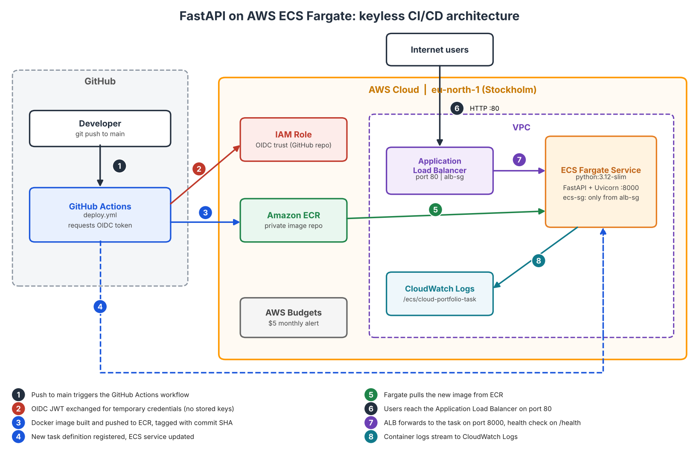
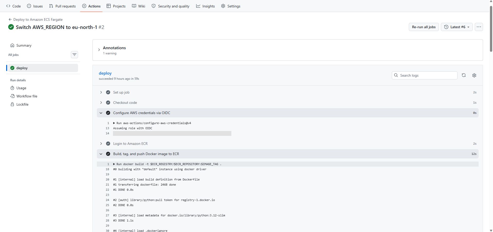
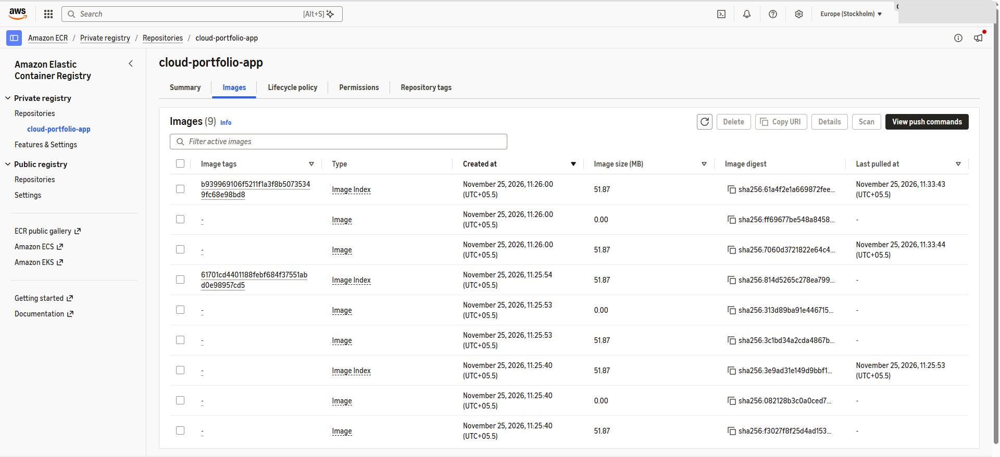
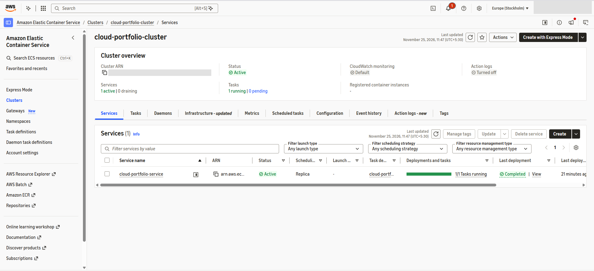
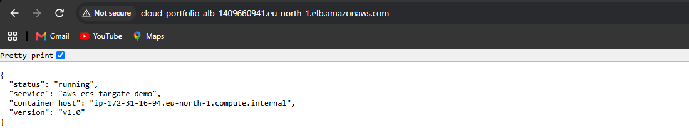
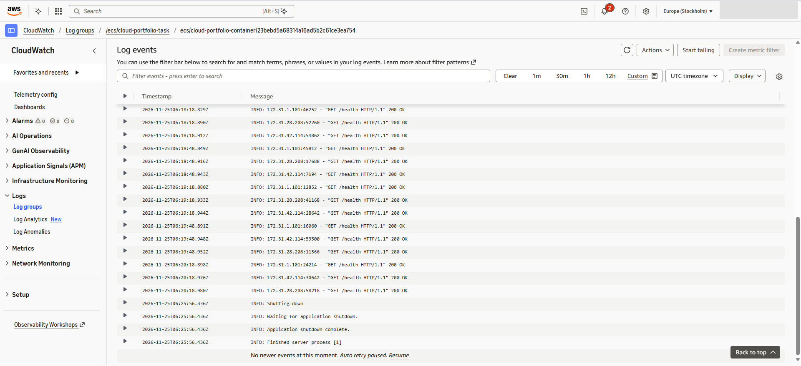
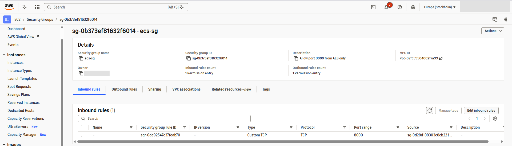

# Containerized FastAPI Microservice on AWS ECS Fargate (Keyless GitHub Actions CI/CD)

A production-style cloud deployment pipeline that automatically builds, containerizes, and deploys a Python FastAPI microservice to **Amazon ECS Fargate** behind an **Application Load Balancer**, authenticated via **GitHub Actions OIDC** (zero static AWS access keys).



## Architecture Flow
1. **Source & CI/CD:** Pushing to `main` triggers GitHub Actions (`.github/workflows/deploy.yml`).
2. **Keyless Authentication (OIDC):** GitHub exchanges a short-lived OIDC JWT token with AWS IAM (`sts:AssumeRoleWithWebIdentity`) for temporary deployment credentials.
3. **Container Registry:** Docker builds the `python:3.12-slim` image and pushes it to a private **Amazon ECR** repository (`eu-north-1`), tagged with the commit SHA.
4. **Serverless Compute & Networking:** **Amazon ECS Fargate** runs the container on port `8000` inside a VPC, isolated by a Security Group (`ecs-sg`) that only accepts traffic from the **Application Load Balancer** (`alb-sg`, port `80`).
5. **Health Checks & Cost Guardrails:** The ALB monitors `/health`, container logs stream to **Amazon CloudWatch**, and an **AWS Budgets** alert is set at $5 per month.

## AWS Services & Tools Used
- **Compute & Containers:** Amazon ECS (AWS Fargate), Amazon ECR, Docker
- **Networking & Security:** VPC, Application Load Balancer (ALB), Security Groups (least-privilege chaining), AWS IAM (OIDC Federation)
- **CI/CD & Monitoring:** GitHub Actions, Amazon CloudWatch Logs, AWS Budgets
- **Application:** Python 3.12, FastAPI, Uvicorn

## Deployment Proof

### 1. CI/CD pipeline (keyless OIDC)

*The workflow assumes an IAM role via GitHub OIDC ("Assuming role with OIDC"). No AWS access keys are stored in GitHub.*

### 2. Images in Amazon ECR

*Images pushed by the pipeline and tagged with the Git commit SHA.*

### 3. ECS Fargate service running

*Service ACTIVE with 1/1 tasks running on Fargate in `eu-north-1`.*

### 4. Live endpoint (through the ALB)


### 5. CloudWatch logs

*Container logs streaming to CloudWatch. The ALB health checks hit `/health` and receive `200 OK`.*

### 6. Network isolation

*`ecs-sg` accepts port 8000 only from the ALB security group (`alb-sg`), not from `0.0.0.0/0`.*

### 7. Cost guardrail
An AWS Budgets alert is configured at $5 per month.

> The load balancer and running tasks were shut down after testing to avoid charges.

## Cleanup
```bash
# Scale the service to zero, then delete it and the cluster
aws ecs update-service --cluster cloud-portfolio-cluster --service cloud-portfolio-service --desired-count 0 --region eu-north-1
aws ecs delete-service --cluster cloud-portfolio-cluster --service cloud-portfolio-service --force --region eu-north-1
aws ecs delete-cluster --cluster cloud-portfolio-cluster --region eu-north-1

# Delete the load balancer (console: EC2 > Load Balancers), then the target group and ECR repo
aws ecr delete-repository --repository-name cloud-portfolio-app --force --region eu-north-1

# Stop log storage growing
aws logs put-retention-policy --log-group-name /ecs/cloud-portfolio-task --retention-in-days 7 --region eu-north-1
```

## Re-deploying
Push any commit to `main`, or use **Actions > Re-run all jobs**, and the pipeline rebuilds the image and updates the ECS service.
